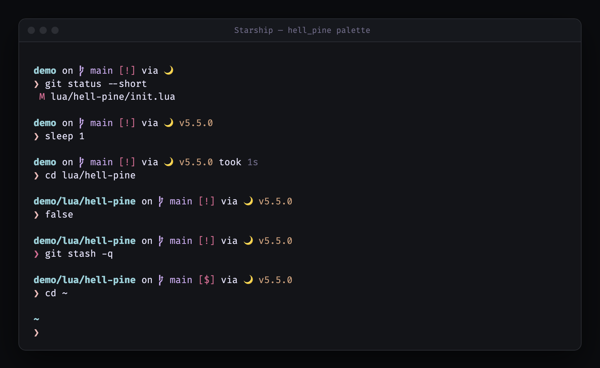

# Hell Pine for Starship

A darker, higher-contrast take on Rosé Pine, born inside tmux, for Starship.



Captured from Starship with this palette: directory in foam, branch in iris, git status in love, language version in gold.

## Install

Add the `[palettes.hell_pine]` table from [`hell-pine.toml`](hell-pine.toml) to `~/.config/starship.toml`, and set
at the top:

```toml
palette = "hell_pine"
```

Styles can then name the colours: `style = "bold rose"`, `style = "foam"`, and so on.

## Palette


## Other ports

Hell Pine comes from the [VS Code theme](https://github.com/abxengg/hell-pine). Every port is made from the one
palette in [hell-pine.nvim](https://github.com/abxengg/hell-pine.nvim) by its `scripts/extras.py`, so the colours stay the
same everywhere: [Neovim](https://github.com/abxengg/hell-pine.nvim),
[Ghostty](https://github.com/abxengg/hell-pine-ghostty), [WezTerm](https://github.com/abxengg/hell-pine-wezterm), [kitty](https://github.com/abxengg/hell-pine-kitty), [Alacritty](https://github.com/abxengg/hell-pine-alacritty), [tmux](https://github.com/abxengg/hell-pine-tmux), [btop](https://github.com/abxengg/hell-pine-btop), [fish](https://github.com/abxengg/hell-pine-fish), [Zed](https://github.com/abxengg/hell-pine-zed), [fzf](https://github.com/abxengg/hell-pine-fzf).

To change a colour, edit the palette there and run the script; do not edit `hell-pine.toml` by hand.

## Licence

MIT, see [LICENSE](LICENSE).
